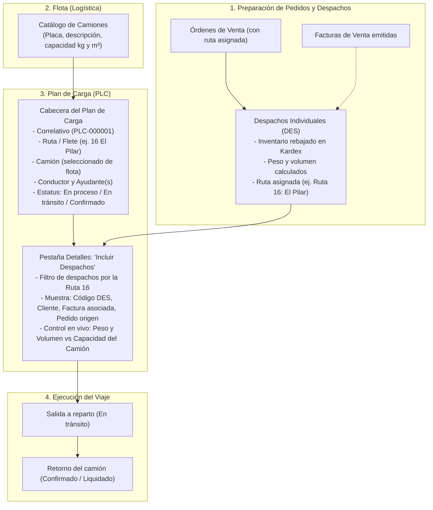

# Módulo de Logística: Camiones y Planes de Carga

Este documento describe la especificación técnica y funcional para la gestión de flota (**Camiones**) y la consolidación de viajes (**Planes de Carga**) en el ERP.

Se integra de forma no invasiva con los módulos existentes de **Despachos** (`app_dispatches`) y **Rutas** (`app_routes`), adaptando el sistema al flujo operativo real de empresas distribuidoras mayoristas.

---

## 1. Visión General del Flujo Adaptado

---

## 2. Camiones / Flota — `app_vehicles` — Prefijo `CAM`

Tabla de módulo que centraliza los vehículos de reparto de la empresa o fletes fijos. Elimina el uso de placas en texto libre y centraliza los límites de carga física.

### 2.1 Estructura — `app_vehicles`

| Columna | Tipo | Nulo | Default | Descripción |
| :--- | :--- | :--- | :--- | :--- |
| `id` | `uuid` | No | | PK. |
| `company_id` | `uuid` | Sí | | FK → `app_companies.id` (`nullOnDelete`). |
| `code` | `string(12)` | Sí | | Código correlativo del sistema (`CAM000001`). |
| `plate` | `string(20)` | No | | Placa del vehículo (única por empresa). Ej. `A12BC3D`. |
| `name` | `string(150)` | No | | Nombre o descripción corta (ej. `Ford Cargo 1721 Blanco`, `NPR Cava 01`). |
| `brand` | `string(80)` | Sí | | Marca (ej. `Chevrolet`, `Ford`, `Iveco`). |
| `model` | `string(80)` | Sí | | Modelo (ej. `FVR`, `NPR`, `Super Duty`). |
| `year` | `integer` | Sí | | Año de fabricación. |
| `vehicle_type` | `enum` | No | `'truck'` | `pickup`, `cava_350`, `truck`, `heavy_truck`, `other`. |
| `capacity_weight`| `decimal(18,4)` | No | `0` | Capacidad máxima de carga en kilogramos (kg). |
| `capacity_volume`| `decimal(18,4)` | No | `0` | Capacidad volumétrica máxima en metros cúbicos ($m^3$). |
| `notes` | `text` | Sí | | Notas adicionales (seguro, revisiones, chofer asignado habitual). |
| `status` | `enum` | No | `'active'` | `active` (operativo), `maintenance` (en taller), `inactive`. |
| `created_by` | `uuid` | Sí | | FK → `users.id`. |
| `created_at` / `updated_at` | `timestamp` | Sí | | |

**Índices:** `unique(company_id, plate)`, `index(status)`, `index(company_id)`.

---

## 3. Planes de Carga — `app_load_plans` — Prefijo `PLC`

Documento operativo que representa un viaje de reparto. Agrupa múltiples **Despachos** que van hacia una misma ruta o zona en un vehículo determinado.

### 3.1 Cabecera — `app_load_plans`

| Columna | Tipo | Nulo | Default | Descripción |
| :--- | :--- | :--- | :--- | :--- |
| `id` | `uuid` | No | | PK. |
| `company_id` | `uuid` | Sí | | FK → `app_companies.id`. |
| `code` | `string(12)` | Sí | | Correlativo del plan (`PLC000001`). |
| `plan_date` | `date` | No | | Fecha programada del viaje/reparto. |
| `route_id` | `uuid` | No | | FK → `app_routes.id` (`restrictOnDelete`). Ruta/Flete del viaje (ej. 16 - El Pilar). |
| `warehouse_id` | `uuid` | No | | FK → `app_warehouses.id` (`restrictOnDelete`). Bodega desde donde se carga. |
| `vehicle_id` | `uuid` | No | | FK → `app_vehicles.id` (`restrictOnDelete`). Camión asignado. |
| `driver_name` | `string(150)`| No | | Nombre del conductor / chofer (y su cédula). |
| `driver_id` | `uuid` | Sí | | FK opcional → `users.id` (si el chofer tiene usuario en el ERP). |
| `helper_name` | `string(255)`| Sí | | Nombre(s) y cédula(s) del personal de apoyo / ayudantes / caleteros. |
| `description` | `text` | Sí | | Descripción u observaciones generales del viaje. |
| `total_dispatches` | `integer` | No | `0` | Cantidad de despachos incluidos en el plan. |
| `total_weight` | `decimal(18,4)` | No | `0` | Suma del peso total de los despachos (kg). |
| `total_volume` | `decimal(18,4)` | No | `0` | Suma del volumen total de los despachos ($m^3$). |
| `status` | `enum` | No | `'draft'` | `draft` (En proceso), `in_transit` (En tránsito), `confirmed` (Confirmado / Entregado), `cancelled` (Anulado). |
| `created_by` | `uuid` | Sí | | FK → `users.id`. |
| `created_at` / `updated_at` | `timestamp` | Sí | | |

**Estados y Transiciones (`status`):**
- `draft` (En proceso): Se arma el plan de carga, se agregan o quitan despachos, se verifica peso y volumen.
- `in_transit` (En tránsito): El camión fue cargado y sale a la ruta a entregar.
- `confirmed` (Confirmado): El camión regresó a la distribuidora; viaje completado.
- `cancelled` (Anulado): Se desasocian los despachos para que puedan cargarse en otro viaje.

Transiciones válidas:
- `draft` → `in_transit`, `cancelled`
- `in_transit` → `confirmed`, `draft` (retorno por emergencia), `cancelled`
- `confirmed` → [] (terminal)
- `cancelled` → [] (terminal)

---

### 3.2 Detalle de Despachos del Plan — `app_load_plan_dispatches`

Tabla de detalle que vincula los despachos asignados a este viaje.

| Columna | Tipo | Nulo | Default | Descripción |
| :--- | :--- | :--- | :--- | :--- |
| `id` | `uuid` | No | | PK. |
| `company_id` | `uuid` | Sí | | FK → `app_companies.id`. |
| `load_plan_id` | `uuid` | No | | FK → `app_load_plans.id` (`cascadeOnDelete`). |
| `dispatch_id` | `uuid` | No | | FK → `app_dispatches.id` (`restrictOnDelete`). |
| `sequence` | `integer` | No | `0` | Orden de entrega en la ruta (secuencia de visita). |
| `status` | `enum` | No | `'active'` | `active` / `inactive`. |
| `created_at` / `updated_at` | `timestamp` | Sí | | |

**Restricciones e Índices:**
- `unique(load_plan_id, dispatch_id)`: Un despacho no se repite en el mismo plan.
- Un despacho activo no puede estar asignado a más de un Plan de Carga con estado `draft` o `in_transit`.

---

## 4. Dinámica de la Pestaña "Detalles" (Inclusión de Despachos)

1. **Búsqueda e Inclusión:**
   - Al pulsar el botón **"Incluir Despachos"**, se abre un selector modal que consulta los despachos pendientes de entrega (`delivery_status != 'delivered'` y `status != 'cancelled'`).
   - El sistema **pre-filtra por la ruta seleccionada en la cabecera** (`route_id`), mostrando únicamente los despachos de clientes correspondientes a esa ruta (ej. *Flete 16 - El Pilar*).
   - Opcionalmente, permite marcar una casilla *"Ver todas las rutas"* por si se necesita incorporar un despacho especial de paso.

2. **Columnas Visibles en el Selector de Despachos:**
   - **N° Despacho:** Código correlativo (`DES000012`).
   - **Cliente:** Nombre comercial y código del cliente destinatario.
   - **N° Factura:** Código de la Factura de Venta asociada a la orden de venta que generó el despacho (`FVE-000089`), o de la factura origen directa.
   - **N° Pedido:** Código de la Orden de Venta origen (`PED-000045`).
   - **Cant. Bultos / Unidades:** Total de unidades o bultos de las líneas.
   - **Peso (kg):** `total_weight` del despacho.
   - **Volumen ($m^3$):** `total_volume` del despacho.

3. **Monitoreo de Capacidad en Tiempo Real:**
   - La pantalla calcula la suma de los despachos agregados:
     $$\text{Peso Acumulado} = \sum \text{total\_weight}_{\text{despachos}}$$
     $$\text{Volumen Acumulado} = \sum \text{total\_volume}_{\text{despachos}}$$
   - Muestra dos barras visuales de progreso comparando contra el camión asignado:
     - **Capacidad de Peso:** `3,850.00 kg / 4,500.00 kg (85.5%)`
     - **Capacidad de Volumen:** `14.20 m³ / 18.00 m³ (78.8%)`
   - Si la suma sobrepasa la capacidad declarada del vehículo, la barra cambia a color de advertencia (rojo) indicando sobrecarga.

---

## 5. Salidas Operativas Futuras (Fase 2 de Planes de Carga)

Una vez consolidada la estructura de datos y el flujo básico, se habilitarán las siguientes herramientas para la operación:

1. **Hoja de Carga (Picking Consolidado de Almacén):**
   - Agrupa la suma de todos los artículos de todos los despachos incluidos en el plan, permitiendo al personal de bodega cargar el camión en bloque.
2. **Hoja de Ruta y Relación de Cobranza:**
   - Documento para el chofer y los ayudantes con el orden de las paradas, facturas amparadas y montos a cobrar (condición de crédito o contado).
3. **Liquidación del Plan al Retorno:**
   - Conciliación de entregas efectivas, reingreso de mercancía rechazada y cuadre de cobranzas recaudadas en ruta.
