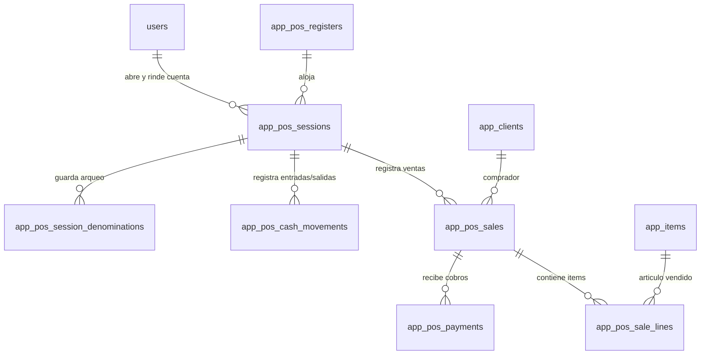
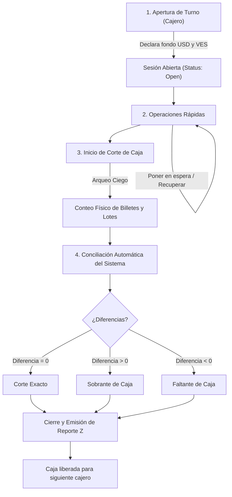
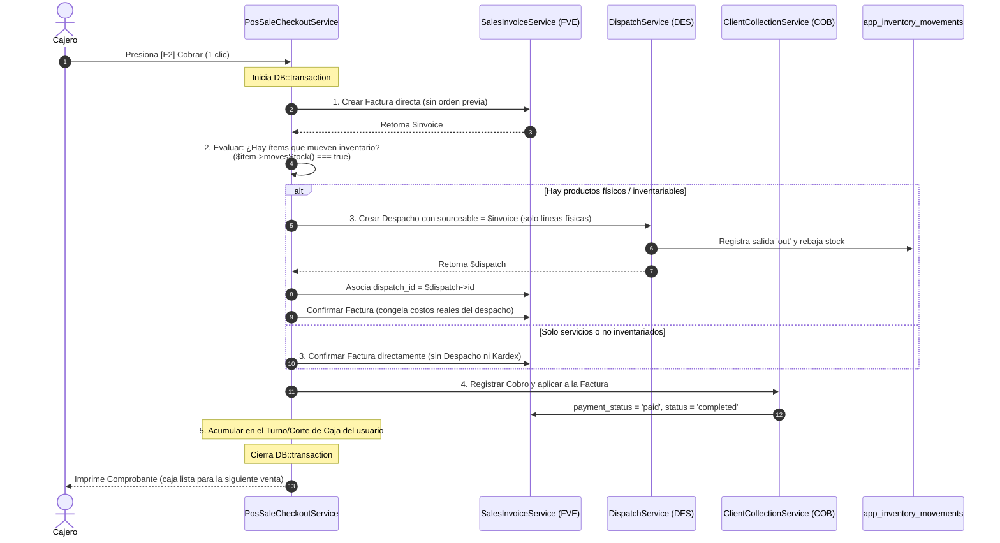

# Punto de Venta (POS) y Facturación Rápida

Módulo para ventas directas de mostrador y cobro inmediato en tiendas físicas, diseñado para máxima velocidad operativa, interfaz sencilla e intuitiva, y control estricto de caja individualizada por usuario.

> Las columnas base (`id`, `company_id`, `code`, `status`, `created_by`, `created_at`, `updated_at`), los índices base, la política de no borrado, los tipos numéricos y el uso de `yes`/`no` siguen las convenciones descritas en [README.md](README.md) y [monedas.md](monedas.md).

| Módulo / Entidad              | Tabla                           | Prefijo | Tipo de tabla    |
|-------------------------------|---------------------------------|---------|------------------|
| Cajas registradoras / Puntos  | `app_pos_registers`             | `CAJ`   | Tabla de módulo  |
| Sesiones y Cortes de caja     | `app_pos_sessions`              | `COR`   | Tabla de módulo  |
| Ventas rápidas POS / Tickets  | `app_pos_sales`                 | `POS`   | Tabla de módulo  |
| Líneas de venta POS           | `app_pos_sale_lines`            | —       | Tabla de detalle |
| Pagos y formas de cobro POS   | `app_pos_payments`              | —       | Tabla de detalle |
| Movimientos de efectivo en caja | `app_pos_cash_movements`       | —       | Tabla de detalle |
| Desglose de arqueo (billetes) | `app_pos_session_denominations` | —       | Tabla de detalle |

**Depende de:** [Inventario](inventario.md) (artículos, existencias y bodega asignada a la caja), [Catálogo](catalogo.md) (listas de precio, impuestos), [Ventas](ventas.md) (clientes) y [Monedas](monedas.md) (tasas de cambio oficial/paralelo).

**Flujo general:** Apertura de turno individual → Escaneo rápido de artículos → Cobro express multimoneda → Emisión de ticket y rebaja automática de stock → Arqueo ciego → Corte de caja individual por usuario.

---

## 1. Decisiones de diseño y arquitectura

### 1.1 Qué se decidió y por qué

| Decisión | Motivo |
|---|---|
| **Separación de Caja física (`app_pos_registers`) vs Turno de usuario (`app_pos_sessions`).** | La caja registradora es el equipo físico (computadora, gaveta de dinero, impresora térmica, bodega asociada). La sesión es el turno de trabajo temporal que abre un usuario específico. |
| **Cada corte pertenece estrictamente a un solo usuario.** | **Responsabilidad individual:** si dos cajeros comparten la misma sesión de caja, cuando hay un faltante de dinero nadie es responsable. Con sesiones individuales, cada usuario sabe exactamente qué vendió, cuánto cobró y cuánto dinero debe haber en su gaveta al entregar la guardia. |
| **Una sesión activa por usuario y una sesión activa por caja.** | Un usuario no puede tener abiertos dos turnos a la vez. Del mismo modo, una caja física no puede tener dos cajeros operando al mismo tiempo: para que entre el siguiente cajero, el anterior debe realizar su corte y cerrar su sesión. |
| **Operación en 1 solo paso atómico (Checkout express).** | En el flujo B2B del ERP una venta toma 4 pasos (`OVE` → `DES` → `FVE` → `COB`). En mostrador minorista el cliente espera ser despachado en 20 segundos. El POS procesa en una sola transacción de base de datos la venta, los cobros recibidos y la salida física de inventario. |
| **Factura como origen comercial y Despacho originado por `sourceable`.** | La venta en mostrador nace como una Factura de Venta directa (`FVE`). Si la factura contiene artículos que mueven inventario (`Item::movesStock()`), genera automáticamente un Despacho (`DES`) donde `sourceable_type = 'sales_invoice'` y `sourceable_id = invoice.id`. Si la factura es solo de servicios o ítems no inventariados, **no se genera despacho**. Esto aprovecha la relación polimórfica del ERP y mantiene intacta la regla del kardex. |
| **Multimoneda nativa con cálculo de vueltos mixtos.** | En Venezuela se cobra a diario en USD efectivo, Bolívares (Punto de venta, Pago Móvil) y EUR. El sistema calcula equivalencias al instante con la tasa del día y asiste al cajero para calcular el cambio exacto en divisas o en bolívares. |
| **Arqueo ciego (Blind Close).** | Al hacer el corte de caja, el sistema no le revela al cajero cuánto dinero espera que haya. El cajero cuenta el dinero físico real y lo declara. El sistema calcula la diferencia (sobrante o faltante). Esto previene que se maquillen descuadres. |
| **Interfaz optimizada para teclado y lector de código de barras.** | La pantalla POS debe operarse sin necesidad de ratón. Todo el flujo (buscar, cambiar cantidades, aplicar descuentos, abrir ventana de cobro y finalizar venta) tiene atajos de teclado estandarizados (`F1`-`F12`). |
| **Venta a Consumidor Final de 1 clic y creación rápida de clientes.** | El 80% de las ventas de mostrador van a cliente genérico. Para clientes que requieren factura fiscal con RIF, se puede buscar o registrar en un modal rápido sin abandonar la pantalla de cobro. |
| **Ventas en espera (Hold / Resume).** | Si un cliente en caja olvida un producto o va a buscar su billetera, el cajero puede pausar el ticket (`F8`) y atender al siguiente cliente en la fila sin perder los artículos ya escaneados. |

### 1.2 Qué no se hace (por ahora)

- No se permiten turnos compartidos o fondos acumulados entre múltiples usuarios.
- No hay ventas a crédito directas en POS salvo que el cliente esté registrado en `app_clients`, tenga cupo de crédito activo (`credit_limit > 0`) y no esté bloqueado.
- No se maneja venta de productos con lotes o series manuales en el checkout rápido del POS: si un artículo requiere control de series/lotes estrictos, se despacha por el flujo de ventas regular o se asigna por método FIFO automático en la bodega del mostrador.

---

## 2. Modelo de datos



### 2.1 Cajas registradoras / Terminales físicas — `app_pos_registers`

Identifica cada estación física de cobro (computador o terminal táctil, gaveta de dinero y su bodega física correspondiente).

**Prefijo:** `CAJ` — **Tabla de módulo**

| Columna | Tipo | Nulo | Default | Descripción |
|---|---|---|---|---|
| `name` | `string(100)` | No | | Nombre descriptivo (ej: "Caja Principal 01", "Caja Rápida"). |
| `warehouse_id` | `uuid` | No | | FK → `app_warehouses.id`. Bodega de donde se descarga el stock vendido en esta caja. |
| `price_list_id` | `uuid` | Sí | | FK → `app_price_lists.id`. Lista de precios por defecto de la caja. |
| `default_client_id` | `uuid` | No | | FK → `app_clients.id`. Cliente por defecto ("Consumidor Final / Mostrador"). |
| `receipt_printer_name` | `string(100)` | Sí | | Nombre de la impresora de tickets / comanda en el equipo. |
| `invoice_series` | `string(20)` | Sí | | Serie asignada para tickets o facturación fiscal de esta caja. |
| `allow_price_override` | `enum` | No | `'no'` | `yes` / `no`. Si los cajeros en esta terminal pueden cambiar precios unitarios. |
| `allow_custom_discounts` | `enum` | No | `'no'` | `yes` / `no`. Si permite aplicar descuentos directos por línea o venta. |
| `max_discount_percent` | `decimal(7,4)` | No | `0` | Porcentaje máximo de descuento permitido sin clave de supervisor. |
| `notes` | `text` | Sí | | Observaciones sobre la ubicación o hardware. |

**Índices:** `unique(company_id, code)`, `unique(company_id, name)`, `index(warehouse_id)`, `index(status)`.

---

### 2.2 Sesiones y Cortes de caja por usuario — `app_pos_sessions`

Representa el turno individual de un usuario en una caja. Es la unidad central donde se calcula el **corte de caja**.

**Prefijo:** `COR` — **Tabla de módulo**

> [!IMPORTANT]
> **Regla de oro de responsabilidad:** `user_id` es el usuario que abrió y manejó el dinero en el turno. Solo ese usuario puede operar ventas en esta sesión. Al terminar el turno se ejecuta el arqueo y el corte, congelando los totales para auditoría.

| Columna | Tipo | Nulo | Default | Descripción |
|---|---|---|---|---|
| `pos_register_id` | `uuid` | No | | FK → `app_pos_registers.id`. Caja física donde se trabaja. |
| `user_id` | `uuid` | No | | FK → `users.id`. Cajero responsable del turno y del dinero. |
| `opened_at` | `datetime` | No | | Fecha y hora exacta de apertura. |
| `closed_at` | `datetime` | Sí | | Fecha y hora exacta del corte y cierre. |
| `opening_cash_usd` | `decimal(18,2)` | No | `0` | Fondo inicial de caja en efectivo USD (dólares en billetes). |
| `opening_cash_ves` | `decimal(18,2)` | No | `0` | Fondo inicial de caja en efectivo VES (bolívares en billetes). |
| `expected_cash_usd` | `decimal(18,2)` | No | `0` | Efectivo USD esperado al cierre (calculado por el sistema). |
| `expected_cash_ves` | `decimal(18,2)` | No | `0` | Efectivo VES esperado al cierre (calculado por el sistema). |
| `expected_card_ves` | `decimal(18,2)` | No | `0` | Total esperado por tarjetas de débito/crédito en bolívares. |
| `expected_mobile_ves` | `decimal(18,2)` | No | `0` | Total esperado por Pago Móvil en bolívares. |
| `expected_other` | `decimal(18,2)` | No | `0` | Total esperado por otros medios (transferencias, vales, etc.). |
| `declared_cash_usd` | `decimal(18,2)` | Sí | | Efectivo USD contado físicamente y declarado por el cajero. |
| `declared_cash_ves` | `decimal(18,2)` | Sí | | Efectivo VES contado físicamente y declarado por el cajero. |
| `declared_card_ves` | `decimal(18,2)` | Sí | | Total vouchers reportado según cierre de lote bancario. |
| `declared_mobile_ves`| `decimal(18,2)` | Sí | | Total reportado según comprobantes de Pago Móvil. |
| `declared_other` | `decimal(18,2)` | Sí | | Total declarado de otros instrumentos. |
| `difference_cash_usd`| `decimal(18,2)` | Sí | | `declared_cash_usd - expected_cash_usd` (positivo = sobrante, negativo = faltante). |
| `difference_cash_ves`| `decimal(18,2)` | Sí | | `declared_cash_ves - expected_cash_ves` (sobrante o faltante en Bs). |
| `sales_count` | `integer` | No | `0` | Número total de ventas completadas en el turno. |
| `cancelled_sales_count` | `integer` | No | `0` | Número de tickets anulados en el turno. |
| `total_sales_amount` | `decimal(18,2)` | No | `0` | Total facturado en moneda base (USD) durante el turno. |
| `total_discounts_amount` | `decimal(18,2)` | No | `0` | Total en descuentos aplicados durante el turno. |
| `supervisor_id` | `uuid` | Sí | | FK → `users.id`. Supervisor que autorizó el cierre con descuadre si aplica. |
| `closing_notes` | `text` | Sí | | Justificaciones de diferencias o novedades del turno. |

**Estados (`status`):**
- `draft`: Apertura en configuración preliminar (si aplica).
- `confirmed` (o `open`): Sesión abierta y operativa; la caja está lista para emitir tickets.
- `completed` (o `closed`): Corte de caja finalizado. Se congelan todos los cálculos y no admite más ventas.
- `cancelled`: Anulada por el administrador (solo si no registró ninguna venta).

**Índices:** `unique(company_id, code)`, `index(pos_register_id)`, `index(user_id)`, `index(opened_at)`, `index(closed_at)`, `index(status)`.

---

### 2.3 Movimientos de efectivo en caja — `app_pos_cash_movements`

Registra cualquier dinero que entra o sale de la gaveta física durante el turno y que **no** proviene de una venta directa.

**Tabla de detalle** (sin `code`, con `company_id` y `status`)

| Columna | Tipo | Nulo | Default | Descripción |
|---|---|---|---|---|
| `pos_session_id` | `uuid` | No | | FK → `app_pos_sessions.id` (`cascadeOnDelete`). Turno en el que ocurrió. |
| `movement_type` | `enum` | No | | `in` (entrada manual de efectivo) o `out` (salida/retiro de efectivo). |
| `concept` | `enum` | No | | `change_replenishment` (recarga de cambio), `cash_drop` (sangría o retiro de seguridad), `expense` (gasto menor de caja chica), `other`. |
| `currency` | `string(3)` | No | `'USD'` | Moneda del movimiento (`USD`, `VES`, etc.). |
| `exchange_rate` | `decimal(18,8)` | No | `1` | Tasa del día al momento del movimiento. |
| `amount` | `decimal(18,2)` | No | `0` | Monto del movimiento. |
| `reason` | `string(255)` | No | | Motivo detallado (ej: "Compra de cinta para impresora", "Retiro de seguridad $300 a caja fuerte"). |
| `authorized_by` | `uuid` | Sí | | FK → `users.id`. Supervisor que autorizó la salida si fue necesario. |

**Índices:** `index(pos_session_id)`, `index(movement_type)`, `index(created_at)`.

---

### 2.4 Ventas POS / Tickets de mostrador — `app_pos_sales`

Cabecera de la venta rápida. Si el cliente requiere factura fiscal, esta cabecera se vincula o emite la `app_sales_invoices` correspondiente.

**Prefijo:** `POS` — **Tabla de módulo**

| Columna | Tipo | Nulo | Default | Descripción |
|---|---|---|---|---|
| `pos_session_id` | `uuid` | No | | FK → `app_pos_sessions.id`. Turno y corte al que suma esta venta. |
| `pos_register_id` | `uuid` | No | | FK → `app_pos_registers.id`. Caja donde se cobró. |
| `client_id` | `uuid` | No | | FK → `app_clients.id`. Cliente de la venta (por defecto Consumidor Final). |
| `sales_invoice_id` | `uuid` | Sí | | FK → `app_sales_invoices.id`. Factura fiscal formal generada si el cliente la solicitó. |
| `dispatch_id` | `uuid` | Sí | | FK → `app_dispatches.id`. Despacho automático de almacén que rebajó el stock. |
| `sale_date` | `datetime` | No | | Fecha y hora exacta de emisión. |
| `currency` | `string(3)` | No | `'USD'` | Moneda principal del documento. |
| `exchange_rate` | `decimal(18,8)` | No | `1` | Tasa cambiaria oficial (BCV o la configurada) congelada al momento de la venta. |
| `subtotal` | `decimal(18,2)` | No | `0` | Suma de subtotales de líneas activas antes de descuentos. |
| `discount_amount` | `decimal(18,2)` | No | `0` | Descuento total aplicado a la venta. |
| `tax_amount` | `decimal(18,2)` | No | `0` | Monto total de impuestos (IVA 16%). |
| `igtf_amount` | `decimal(18,2)` | No | `0` | Impuesto IGTF (3%) si aplica sobre cobros en divisas. |
| `total` | `decimal(18,2)` | No | `0` | Total neto a pagar en moneda del documento (`USD`). |
| `total_in_local_currency` | `decimal(18,2)` | No | `0` | `total * exchange_rate` (Total en Bolívares al cambio oficial). |
| `paid_amount` | `decimal(18,2)` | No | `0` | Suma total recibida de los pagos. |
| `change_amount_usd` | `decimal(18,2)` | No | `0` | Vuelto entregado al cliente en efectivo dólares. |
| `change_amount_ves` | `decimal(18,2)` | No | `0` | Vuelto entregado al cliente en bolívares. |
| `cancelled_at` | `timestamp` | Sí | | Fecha de anulación si fue cancelada. |
| `cancellation_reason` | `string(255)` | Sí | | Motivo de anulación. |
| `cancelled_by` | `uuid` | Sí | | FK → `users.id`. Usuario o supervisor que anuló la venta. |

**Estados (`status`):**
- `draft`: Venta en edición en pantalla o en espera (*Hold*).
- `completed`: Cobrada, ticket impreso y stock descargado.
- `cancelled`: Anulada por el cajero/supervisor. Revierte el despacho automático y anula los cobros.

**Índices:** `unique(company_id, code)`, `index(pos_session_id)`, `index(pos_register_id)`, `index(client_id)`, `index(sale_date)`, `index(status)`.

---

### 2.5 Líneas de venta POS — `app_pos_sale_lines`

**Tabla de detalle** (sin `code`, con `company_id` y `status`)

| Columna | Tipo | Nulo | Default | Descripción |
|---|---|---|---|---|
| `pos_sale_id` | `uuid` | No | | FK → `app_pos_sales.id` (`cascadeOnDelete`). |
| `line_number` | `integer` | No | | Orden de la línea en el ticket. |
| `item_id` | `uuid` | No | | FK → `app_items.id`. Producto vendido. |
| `measurement_unit_id` | `uuid` | No | | FK → `app_measurement_units.id`. Unidad de medida usada. |
| `quantity` | `decimal(18,4)` | No | `1` | Cantidad vendida. |
| `base_quantity` | `decimal(18,4)` | No | `1` | Cantidad en unidad base de inventario. |
| `unit_price` | `decimal(18,6)` | No | `0` | Precio unitario congelado. |
| `unit_cost` | `decimal(18,6)` | No | `0` | Costo promedio del artículo al momento de la venta. |
| `discount_percent` | `decimal(7,4)` | No | `0` | Descuento porcentual en la línea. |
| `discount_amount` | `decimal(18,2)` | No | `0` | Descuento en monto en la línea. |
| `tax_id` | `uuid` | Sí | | FK → `app_taxes.id`. Impuesto aplicable (IVA general, exento, etc.). |
| `tax_percent` | `decimal(7,4)` | No | `0` | Porcentaje de impuesto. |
| `tax_amount` | `decimal(18,2)` | No | `0` | Monto de impuesto de la línea. |
| `subtotal` | `decimal(18,2)` | No | `0` | `quantity * unit_price - discount_amount`. |
| `total` | `decimal(18,2)` | No | `0` | `subtotal + tax_amount`. |

**Índices:** `index(pos_sale_id)`, `index(item_id)`, `unique(pos_sale_id, line_number)`.

---

### 2.6 Pagos y formas de cobro POS — `app_pos_payments`

Permite pagos múltiples (split payments) y multimoneda para saldar una venta.

**Tabla de detalle** (sin `code`, con `company_id` y `status`)

| Columna | Tipo | Nulo | Default | Descripción |
|---|---|---|---|---|
| `pos_sale_id` | `uuid` | No | | FK → `app_pos_sales.id` (`cascadeOnDelete`). |
| `pos_session_id` | `uuid` | No | | FK → `app_pos_sessions.id`. Para totalizar el arqueo rápidamente sin joins innecesarios. |
| `payment_method` | `enum` | No | | `cash` (efectivo), `card_debit` (débito), `card_credit` (crédito), `mobile_payment` (pago móvil), `transfer` (transferencia), `credit_note` (vale/devolución), `other`. |
| `currency` | `string(3)` | No | `'USD'` | Moneda en la que el cliente pagó (`USD`, `VES`, etc.). |
| `exchange_rate` | `decimal(18,8)` | No | `1` | Tasa cambiaria aplicada a este cobro. |
| `amount_tendered` | `decimal(18,2)` | No | `0` | Monto entregado por el cliente en la moneda indicada (ej: billete de $50). |
| `amount_applied` | `decimal(18,2)` | No | `0` | Monto que efectivamente se aplica al pago del ticket. |
| `amount_in_document_currency`| `decimal(18,2)` | No | `0` | Monto equivalente en la moneda de la venta (USD). |
| `reference` | `string(60)` | Sí | | Número de referencia bancaria, voucher de punto o teléfono de Pago Móvil. |
| `card_last_digits` | `string(4)` | Sí | | Últimos 4 dígitos de la tarjeta para auditoría de vouchers. |

**Índices:** `index(pos_sale_id)`, `index(pos_session_id)`, `index(payment_method)`.

---

### 2.7 Arqueo detallado de denominaciones — `app_pos_session_denominations`

Guarda el conteo físico billete por billete durante el cierre de caja. Esto provee prueba física inalterable de qué billetes declaró el cajero.

**Tabla de detalle** (sin `code`, con `company_id` y `status`)

| Columna | Tipo | Nulo | Default | Descripción |
|---|---|---|---|---|
| `pos_session_id` | `uuid` | No | | FK → `app_pos_sessions.id` (`cascadeOnDelete`). |
| `currency` | `string(3)` | No | | Moneda (`USD` o `VES`). |
| `denomination` | `decimal(18,2)` | No | | Valor facial del billete o moneda (ej: 100, 50, 20, 10, 5, 1). |
| `count` | `integer` | No | `0` | Cantidad de piezas/billetes contados. |
| `total_amount` | `decimal(18,2)` | No | `0` | `denomination * count`. |

**Índices:** `index(pos_session_id)`.

---

## 3. El ciclo de caja: Turno y Corte por Usuario

El proceso de control de caja sigue un ciclo de 4 fases que garantiza que **cada usuario rinda cuentas exactas de su gestión**:



### 3.1 Apertura de turno individual

Antes de poder registrar la primera venta, el cajero debe abrir su turno:
1. **Validación:** El sistema verifica que:
   - El usuario actual **no** tenga otra sesión abierta en ninguna caja de la empresa.
   - La caja registradora elegida **no** esté ocupada por otro usuario.
2. **Fondo de caja:** El cajero cuenta y declara el dinero recibido como base para dar cambio:
   - Fondo en efectivo USD (`opening_cash_usd`).
   - Fondo en efectivo VES (`opening_cash_ves`).
3. Se crea el registro en `app_pos_sessions` con estado `confirmed` (abierto) y hora de apertura. A partir de este instante, todas las ventas que este cajero realice en esta pantalla se imputan a su sesión.

### 3.2 Movimientos manuales durante el turno

Si durante el turno se requiere mover dinero físico fuera de una venta:
- **Entrada de efectivo (`cash_in`):** Por ejemplo, el administrador le entrega $50 o Bs. 2.000 en billetes pequeños porque se agotó el cambio en la gaveta.
- **Salida de efectivo / Sangría (`cash_drop`):** Por seguridad, cuando la gaveta acumula más de cierto monto (ej. más de $500 en efectivo), el cajero realiza un retiro parcial hacia la caja fuerte principal. Se genera comprobante firmado.
- **Gasto menor de caja chica (`expense`):** Pago de un gasto operativo urgente (ej. hielo, artículos de limpieza) con justificación y comprobante.

Cada movimiento registra su monto, moneda, motivo y supervisor que lo autorizó en `app_pos_cash_movements`.

### 3.3 El Corte de Caja (Arqueo y Cierre)

Al terminar el turno de trabajo o entregar la caja al siguiente cajero:
1. **Bloqueo de nuevas ventas:** El cajero pulsa **"Cerrar Turno / Corte de Caja"**. La pantalla de facturación se pausa.
2. **Arqueo Ciego:** El cajero cuenta lo que tiene físicamente en la gaveta y lo ingresa en pantalla:
   - **Efectivo:** Introduce la cantidad de billetes por denominación (ej: $100 x 3, $50 x 2, $20 x 8; Bs. 100 x 15, etc.).
   - **Puntos de Venta (Tarjetas):** Cierra el lote en el terminal bancario físico e introduce el monto total del comprobante impreso por el datáfono.
   - **Pago Móvil y Transferencias:** Revisa el listado de comprobantes registrados y confirma el total.
3. **Cálculo de la conciliación:** El backend ejecuta la fórmula del arqueo:

$$\text{Efectivo Esperado} = \text{Fondo Inicial} + \sum \text{Ventas Efectivo} + \sum \text{Entradas Manuales} - \sum \text{Salidas Manuales}$$

$$\text{Diferencia} = \text{Monto Declarado} - \text{Monto Esperado}$$

- **Diferencia = 0:** La caja cuadra al centavo.
- **Diferencia > 0 (Sobrante):** Hay más dinero físico del registrado. Se clasifica como sobrante de caja.
- **Diferencia < 0 (Faltante):** Falta dinero físico. Se registra como faltante imputable a la sesión del usuario.
4. **Firma y Cierre Definitivo (Corte Z):** El estado de la sesión cambia a `completed`. Se imprime el Comprobante de Corte de Caja y la caja física queda desvinculada, lista para que el siguiente usuario abra su propio turno.

### 3.4 Reportes de Corte: Corte X vs Corte Z

- **Corte X (Lectura Parcial):** Reporte informativo que el cajero o supervisor puede emitir a mitad del turno para revisar cómo van las ventas acumuladas del día sin cerrar la sesión ni alterar los saldos.
- **Corte Z (Cierre Final de Turno):** Reporte formal que liquida y congela el turno. **Nadie puede volver a vender sobre una sesión cerrada con Corte Z.**

#### Contenido del Reporte de Corte Individual

El comprobante impreso (en formato ticket o PDF) detalla exactamente **quién y cuánto hizo**:

```text
==================================================
           CORPORACION EJEMPLO C.A.
           RIF: J-12345678-9
       REPORTE DE CORTE DE CAJA (CORTE Z)
==================================================
Corte Nro:         COR000142
Caja:              Caja 01 - Mostrador Central
Cajero:            Juan Perez (juan.perez@empresa.com)
Apertura:          2026-10-20 08:00:15
Cierre:            2026-10-20 16:30:22
--------------------------------------------------
RESUMEN DE OPERACIONES
--------------------------------------------------
Cantidad de ventas realizadas:                 84
Cantidad de tickets anulados:                   1
Ticket Promedio:                           $ 18.45
Total Ventas Brutas:                     $ 1,580.00
Descuentos Otorgados:                    $   30.20
Base Imponible (IVA 16%):                $ 1,336.03
Total IVA Recaudado:                     $  213.77
Total Facturado Neto:                    $ 1,549.80
--------------------------------------------------
COBROS POR MEDIO DE PAGO
--------------------------------------------------
Efectivo Dólares (USD):                  $  720.00
Efectivo Bolívares (VES):       Bs. 8,450.00 ($ 169.00)
Punto de Venta / Débito:        Bs. 24,500.00 ($ 490.00)
Pago Móvil:                     Bs. 8,540.00 ($ 170.80)
--------------------------------------------------
AUDITORIA Y CONCILIACION DE EFECTIVO
--------------------------------------------------
[ EFECTIVO USD ]
  (+) Fondo Inicial:                     $  100.00
  (+) Cobros por Ventas:                 $  720.00
  (+) Entradas de Efectivo:              $   50.00
  (-) Retiros / Sangrías de Caja:        $ -400.00
  (=) Total Esperado en Sistema:         $  470.00
  Total Físico Contado y Declarado:      $  470.00
  DIFERENCIA USD:                        $    0.00 (CUADRADO)

[ EFECTIVO VES ]
  (+) Fondo Inicial:                     Bs. 1,000.00
  (+) Cobros por Ventas:                 Bs. 8,450.00
  (-) Gastos Menores:                    Bs.  -500.00
  (=) Total Esperado en Sistema:         Bs. 8,950.00
  Total Físico Contado y Declarado:      Bs. 8,900.00
  DIFERENCIA VES:                        Bs.   -50.00 (FALTANTE)
--------------------------------------------------
Observaciones del Cajero:
"Diferencia de Bs. 50 por redondeo en cambio de la mañana"

_____________________          _____________________
    Firma Cajero                   Firma Supervisor
==================================================
```

---

## 4. Diseño de la Interfaz de Facturación Rápida (UI/UX)

La interfaz del POS está construida para máxima agilidad visual, con una distribución de dos columnas principales:

### 4.1 Mockup de la pantalla principal

```text
+---------------------------------------------------------------------------------------------------------------+
| CAJA: Mostrador 01   | CAJERO: Juan Perez   | TURNO: COR000142 | TASA: 50.00 VES/USD | [F10 Retiro] [Cerrar Turno] |
+-------------------------------------------------------------------+-------------------------------------------+
| [F1] BUSCAR PRODUCTO O ESCANEAR CODIGO DE BARRAS [           ]    | CLIENTE: [F4] Consumidor Final  [Cambiar] |
|-------------------------------------------------------------------|-------------------------------------------|
| Categorías: [Todas] [Bebidas] [Snacks] [Abarrotes] [Limpieza]     | ITEM                 CANT    PRECIO     TOTAL |
|-------------------------------------------------------------------|-------------------------------------------|
| +-----------------+ +-----------------+ +-----------------+       | Refresco Cola 1.5L   2.00    $ 2.00    $ 4.00 |
| | Refresco Cola   | | Harina de Maiz  | | Arroz Blanco 1k |       | Harina de Maiz P.A.N 3.00    $ 1.20    $ 3.60 |
| | $ 2.00          | | $ 1.20          | | $ 1.10          |       | Aceite Vegetal 1L    1.00    $ 3.50    $ 3.50 |
| | Stock: 45       | | Stock: 120      | | Stock: 88       |       |                                           |
| +-----------------+ +-----------------+ +-----------------+       |                                           |
| +-----------------+ +-----------------+ +-----------------+       |                                           |
| | Galletas Choco  | | Pasta Larga 1kg | | Cafe Molido 500g|       |                                           |
| | $ 0.80          | | $ 1.40          | | $ 4.50          |       |                                           |
| | Stock: 15       | | Stock: 60       | | Stock: 32       |       |                                           |
| +-----------------+ +-----------------+ +-----------------+       |                                           |
|                                                                   |-------------------------------------------|
|                                                                   | Subtotal:                         $ 11.10 |
|                                                                   | Descuento [F3]:                    $ 0.00 |
|                                                                   | IVA (16%):                         $ 1.78 |
|                                                                   |-------------------------------------------|
|                                                                   | TOTAL USD:                        $ 12.88 |
|                                                                   | TOTAL BS (Tasa 50.00):         Bs. 644.00 |
|-------------------------------------------------------------------|-------------------------------------------|
| [F8] Poner en Espera   | [F9] Tickets Pausados (2)  | [Esc] Cancelar|           >>> [F2] COBRAR <<<            |
+-------------------------------------------------------------------+-------------------------------------------+
```

### 4.2 Modal de Cobro Express (Checkout Multimoneda)

Al presionar `F2` o la tecla `Espacio`, se despliega de forma instantánea el modal de cobro:

```text
+-----------------------------------------------------------------------+
|                            COBRAR VENTA                               |
|                                                                       |
| TOTAL A PAGAR:      $ 12.88  USD    /    Bs. 644.00  VES              |
| RESTANTE POR PAGAR: $  0.00                                           |
+-----------------------------------------------------------------------+
| FORMA DE PAGO:                                                        |
| [1] Efectivo USD   [2] Efectivo VES   [3] Punto Débito   [4] Pago Móvil|
|                                                                       |
| Monto recibido del cliente:                                           |
| [ $ 20.00 ]   Botones rápidos: [ Exacto ] [ $ 20 ] [ $ 50 ] [ $ 100 ] |
|                                                                       |
| --------------------------------------------------------------------- |
| RESULTADO:                                                            |
| Pagado:          $ 20.00 USD                                          |
| Vuelto a entregar:                                                    |
|                  $  7.12 USD   ó   Bs. 356.00 VES                     |
+-----------------------------------------------------------------------+
| [Enter] Confirmar e Imprimir Ticket                 [Esc] Volver      |
+-----------------------------------------------------------------------+
```

- Si el cajero recibe un billete de $20, el sistema calcula de inmediato: **Vuelto a entregar: $ 7.12 USD (o Bs. 356.00)**.
- **Pagos mixtos (Split Payment):** Permite ingresar $10 en efectivo USD y los restantes Bs. 144.00 con tarjeta de débito en el punto de venta.
- Al pulsar `Enter`, el sistema:
  1. Registra la venta y los cobros.
  2. Descarga el inventario generando el despacho correspondiente.
  3. Envía el ticket a la impresora térmica (sin cuadro de diálogo del navegador).
  4. Abre la gaveta de dinero.
  5. Limpia la pantalla para la siguiente venta en menos de 300 ms.

### 4.3 Gestión de Tickets en Espera (Pausa y Recuperación)

- Si un cliente olvida su dinero o debe buscar otro producto, el cajero pulsa `F8`.
- El carrito actual se guarda en memoria/base de datos con el nombre del cliente y la hora.
- La pantalla queda en blanco inmediatamente para atender al cliente que sigue en la fila.
- Al volver el cliente, el cajero pulsa `F9`, selecciona el ticket en espera con las flechas del teclado y presiona `Enter` para restaurar todos los productos en el carrito.

### 4.4 Tabla de atajos de teclado

| Tecla | Acción |
|---|---|
| `F1` | Enfocar buscador / lector de código de barras. |
| `F2` o `Espacio` | Abrir modal de cobro (Checkout). |
| `F3` | Aplicar descuento a la venta o al ítem seleccionado. |
| `F4` | Cambiar cliente o crear cliente express. |
| `F5` | Modificar cantidad de la línea seleccionada (`+` / `-`). |
| `F6` | Eliminar línea del carrito (con confirmación rápida). |
| `F8` | Poner ticket actual en espera. |
| `F9` | Ver y recuperar tickets en espera. |
| `F10`| Registrar entrada o salida manual de efectivo (sangría / gasto). |
| `F11`| Ver lectura X de caja (arqueo parcial). |
| `F12`| Abrir gaveta eléctrica de dinero (sin venta). |
| `Esc`| Cancelar modal abierto o limpiar carrito vacío. |

---

## 5. Arquitectura backend en Laravel 12

El backend se estructura como un módulo desacoplado dentro de `app/Modules/Pos/`:

```text
app/Modules/Pos/
├── Commands/
│   ├── CreatePosSaleCommand.php
│   ├── OpenPosSessionCommand.php
│   ├── ClosePosSessionCommand.php
│   ├── CreatePosCashMovementCommand.php
│   └── SearchPosSaleCommand.php
├── Controllers/
│   ├── PosRegisterGetController.php
│   ├── PosRegisterPostController.php
│   ├── PosSessionGetController.php
│   ├── PosSessionOpenPostController.php
│   ├── PosSessionClosePostController.php
│   ├── PosSaleCheckoutPostController.php
│   ├── PosSaleHoldPostController.php
│   ├── PosSaleCancelPostController.php
│   └── PosCashMovementPostController.php
├── Models/
│   ├── PosRegister.php
│   ├── PosSession.php
│   ├── PosSale.php
│   ├── PosSaleLine.php
│   ├── PosPayment.php
│   ├── PosCashMovement.php
│   └── PosSessionDenomination.php
├── Repositories/
│   ├── Contracts/
│   │   ├── PosRegisterRepositoryInterface.php
│   │   ├── PosSessionRepositoryInterface.php
│   │   └── PosSaleRepositoryInterface.php
│   ├── PosRegisterRepository.php
│   ├── PosSessionRepository.php
│   └── PosSaleRepository.php
├── Requests/
│   ├── OpenPosSessionRequest.php
│   ├── ClosePosSessionRequest.php
│   ├── PosCheckoutRequest.php
│   └── CreatePosCashMovementRequest.php
├── Resources/
│   ├── PosRegisterResource.php
│   ├── PosSessionResource.php
│   ├── PosSaleResource.php
│   └── PosSessionZReportResource.php
├── Services/
│   ├── PosSessionOpenService.php
│   ├── PosSessionCloseService.php
│   ├── PosSaleCheckoutService.php
│   ├── PosSaleCancelService.php
│   └── PosCashMovementService.php
└── routes.php
```

### 5.1 Servicio de Checkout Atómico (`PosSaleCheckoutService` - Facturación y Despacho con `sourceable`)

Es el motor transaccional del módulo. La venta en mostrador se origina directamente como una **Factura de Venta Directa** ([ventas.md](ventas.md)). Si la venta incluye productos que mueven existencia, la factura genera su **Despacho** ([logistica.md](logistica.md)) usando la relación polimórfica `sourceable`:

```php
public function execute(PosCheckoutCommand $command): SalesInvoice
{
    return DB::transaction(function () use ($command): SalesInvoice {
        // 1. Validar que la sesión de caja esté abierta y pertenezca al usuario activo
        $session = $this->sessionRepository->findOrFail($command->posSessionId);
        $this->ensureSessionIsOpenAndBelongsToUser($session, $command->userId);

        // 2. Paso 1 Comercial: Crear la Factura de Venta directa (FVE)
        // Nace sin orden de venta previa (sourceableType = null).
        $invoice = $this->invoiceCreateService->execute(new CreateSalesInvoiceCommand(
            companyId: $command->companyId,
            clientId: $command->clientId,
            warehouseId: $session->register->warehouse_id,
            sourceableType: null,
            sourceableId: null,
            currency: $command->currency,
            lines: $command->toInvoiceLines(),
        ));

        // 3. Paso 2 Logístico: Evaluar si hay ítems que mueven inventario
        // Se descartan servicios o ítems no inventariados (movesStock() === false).
        $stockableLines = $this->filterStockableLines($invoice);

        if ($stockableLines->isNotEmpty()) {
            // El Despacho toma la Factura como su documento origen polimórfico
            $dispatch = $this->dispatchCreateService->execute(new CreateDispatchCommand(
                companyId: $command->companyId,
                warehouseId: $session->register->warehouse_id,
                recipientType: 'client',
                recipientId: $command->clientId,
                sourceableType: SalesInvoice::MORPH_ALIAS, // 'sales_invoice'
                sourceableId: $invoice->id,
                lines: $this->buildDispatchLinesFromInvoice($stockableLines),
            ));
            
            // Confirmar despacho para rebajar existencias del kardex
            $this->dispatchStatusService->confirm($dispatch);

            // Asociar el despacho a la factura para trazabilidad y costo congelado
            $invoice->update(['dispatch_id' => $dispatch->id]);
        }

        // 4. Confirmar la Factura (congela costos si hubo despacho y activa cuenta por cobrar)
        $this->invoiceStatusService->confirm($invoice);

        // 5. Paso 3 Tesorería: Registrar Cobro (COB) y aplicar a la Factura
        // Cobra en efectivo USD, bolívares en punto, etc. y pasa la factura a 'completed' (pagada).
        $collection = $this->collectionCreateService->execute(new CreateClientCollectionCommand(
            companyId: $command->companyId,
            clientId: $command->clientId,
            originType: 'invoice',
            originId: $invoice->id,
            payments: $command->payments,
        ));

        // 6. Acumular en el Turno/Corte de Caja individual del usuario
        $this->sessionRepository->accumulateSale($session, $invoice, $command->payments);

        return $invoice;
    });
}
```

> [!NOTE]
> **Extensión de `Dispatch::SOURCE_TYPES`:**
> Para que el Despacho admita facturas como documento de origen polimórfico, se agregan a [`Dispatch`](app/Modules/Dispatch/Models/Dispatch.php):
> - `SalesInvoice::MORPH_ALIAS` ('sales_invoice') en `Dispatch::SOURCE_TYPES`.
> - `SalesInvoiceLine::MORPH_ALIAS` ('sales_invoice_line') en `Dispatch::SOURCE_LINE_TYPES`.
>
> De esta forma, el despacho queda perfectamente trazado a la factura y a cada una de sus líneas físicas. Si la venta solo contiene servicios (por ejemplo, asesorías, transporte, mano de obra), la condición `$stockableLines->isEmpty()` evita crear movimientos de despacho o kardex innecesarios.

#### Diagrama de secuencia del Checkout Atómico



### 5.2 Servicio de Cierre de Corte (`PosSessionCloseService`)

```php
public function execute(ClosePosSessionCommand $command): PosSession
{
    return DB::transaction(function () use ($command): PosSession {
        $session = $this->sessionRepository->findOrFail($command->sessionId);

        // Validar que solo el propio usuario o un supervisor autorizado cierre la sesión
        $this->validateClosingAuthorization($session, $command->userId);

        // Calcular los totales esperados según las ventas y movimientos del turno
        $expected = $this->sessionCalculator->calculateExpectedAmounts($session);

        // Registrar las denominaciones contadas en el arqueo físico
        $this->denominationRepository->record($session, $command->denominations);

        // Determinar diferencias (faltante o sobrante)
        $diffCashUsd = $command->declaredCashUsd - $expected->cashUsd;
        $diffCashVes = $command->declaredCashVes - $expected->cashVes;

        // Cerrar y congelar la sesión
        $session->update([
            'closed_at' => now(),
            'status' => 'completed',
            'expected_cash_usd' => $expected->cashUsd,
            'expected_cash_ves' => $expected->cashVes,
            'declared_cash_usd' => $command->declaredCashUsd,
            'declared_cash_ves' => $command->declaredCashVes,
            'difference_cash_usd' => $diffCashUsd,
            'difference_cash_ves' => $diffCashVes,
            'closing_notes' => $command->notes,
            'supervisor_id' => $command->supervisorId,
        ]);

        return $session;
    });
}
```

---

## 6. Arquitectura Frontend (React 19 + Inertia v2 + Tailwind v4)

Los componentes del frontend residen en `resources/js/pages/pos/`:

```text
resources/js/pages/pos/
├── index.tsx                  # Pantalla de venta rápida (terminal POS principal)
├── components/
│   ├── PosHeader.tsx          # Barra superior con estado de caja, cajero y tasa
│   ├── PosSearchInput.tsx     # Buscador con autofocus permanente para lector
│   ├── PosCatalogGrid.tsx     # Botones táctiles de productos favoritos y categorías
│   ├── PosCart.tsx            # Lista de productos escaneados y cantidades
│   ├── PosCartLine.tsx        # Fila individual con controles rápidos
│   ├── PosTotals.tsx          # Totales en USD y VES al cambio
│   ├── PosPaymentModal.tsx    # Modal de cobro express multimoneda
│   ├── PosHoldSalesModal.tsx  # Modal para recuperar ventas en espera
│   ├── PosCashMovementModal.tsx # Modal de entrada/salida de dinero
│   ├── PosCloseSessionModal.tsx # Modal de arqueo y corte de caja
│   └── PosReceiptModal.tsx    # Modal de previsualización e impresión térmica
├── context/
│   ├── PosSessionContext.tsx  # Estado de la sesión, caja física y tasas
│   └── PosCartContext.tsx     # Estado del carrito, cliente y atajos de teclado
├── types/
│   └── Pos.ts                 # Interfaces TypeScript del POS
├── sessions/
│   ├── open.tsx               # Pantalla de apertura de turno (fondo inicial)
│   ├── show.tsx               # Reporte detallado del Corte Z
│   └── index.tsx              # Histórico de cortes de caja
└── registers/
    ├── index.tsx              # Listado y estado de cajas registradoras
    └── create.tsx             # Configuración de nueva caja física
```

### 6.1 Manejo de Impresión Térmica

Para imprimir el ticket sin interrumpir el flujo de venta:
- **Modo directo (Web Print API):** Se inyecta una hoja de estilos específica `@media print` configurada en 80mm o 58mm sin márgenes.
- **Impresión silenciosa:** En terminales dedicadas se configura el flag de Chromium `--kiosk --kiosk-printing`, permitiendo que al pulsar `Enter` el ticket salga disparado por la impresora térmica inmediatamente.

---

## 7. Plan de Implementación por Fases

| Fase | Alcance | Entregables |
|---|---|---|
| **Fase 1: Control de Cajas y Turnos individuales** | Tablas de cajas y sesiones, apertura de turno, fondo inicial, movimientos de efectivo, arqueo ciego, cálculo de faltantes/sobrantes y emisión de Reporte Z por usuario. | `app_pos_registers`, `app_pos_sessions`, `app_pos_cash_movements`, pantalla de apertura y corte de caja. |
| **Fase 2: Facturación Rápida y Terminal POS** | Pantalla de venta express, buscador omnibox, lector de código de barras, atajos de teclado, carrito reactivo, modal de cobro multimoneda y despacho automático a kardex. | `app_pos_sales`, `app_pos_sale_lines`, `app_pos_payments`, pantalla `pos/index.tsx`, `PosSaleCheckoutService`. |
| **Fase 3: Operaciones avanzadas y periféricos** | Ventas en espera (Hold/Resume), integración directa con gaveta de dinero e impresora térmica de tickets (80mm/58mm), impresión de comanda y auditoría gerencial de cortes. | Atajos `F8`/`F9`, modal de tickets en espera, plantillas ESC/POS de ticket térmico, reporte consolidado por cajeros. |
